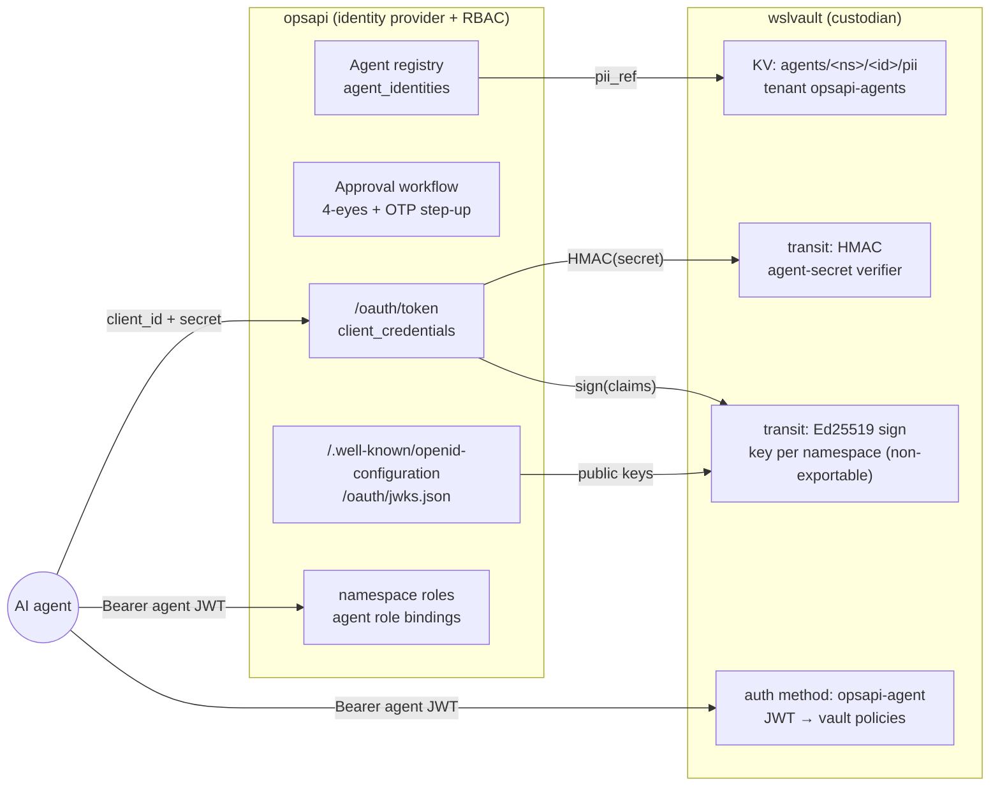
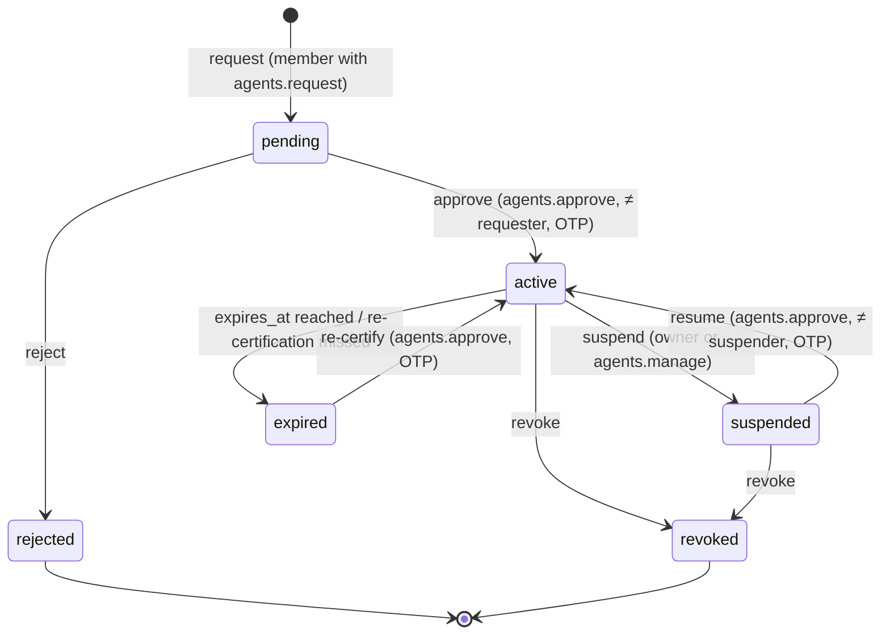

# Governed Agent Identity: opsapi as identity provider, wslvault as custodian

Status: **Accepted**, 2026-11-01 (open questions resolved in §7). Spans two repositories: `bwalia/opsapi` and
`bwalia/wslvault`.

## 1. Problem

Enterprises are deploying AI agents faster than they can verify them. Today an
agent borrows a human's credential: an opsapi `opsk_` key, or a wslvault
`wslv_` key. Its actions are then indistinguishable from that human's. Nobody
approved the agent. It has no stated purpose. Its access ends only when someone
remembers to revoke a personal key. Every agent needs an identity of its own,
and that identity has to be **governed**:

| Property | Meaning |
|---|---|
| Attributable | A stable agent id, distinct from any human, appears in every token and audit event. |
| Owned | Every agent has an accountable human owner. |
| Purpose-bound | It has a declared purpose, and its access is scoped to that purpose. |
| Approved | No credential exists until someone other than the requester approves it, with MFA. |
| Short-lived | Tokens last minutes; the identity itself has an expiry and is re-certified. |
| Revocable | Suspending or revoking an agent stops new tokens immediately and kills live ones within one token lifetime. |
| Private | Tokens and logs carry opaque ids, never personal data. |

## 2. Decision: who owns what

| Concern | Owner | Why |
|---|---|---|
| **Identity provider**: registration, lifecycle, approval, token issuance, OIDC discovery, JWKS, introspection | **opsapi** | Humans, workspaces and approvals already live there; it is where people govern agents. |
| **RBAC**: what an agent may do in opsapi, and who may request, approve or revoke agents | **opsapi** | Uses opsapi's namespace roles (`module.action`) unchanged. Decided at request time, never baked into tokens. |
| **Identity keys**: token-signing keys, agent-secret verification key | **wslvault** | The keys are non-exportable. opsapi asks wslvault to sign or verify and never holds key material, so an opsapi compromise cannot mint tokens offline. |
| **PII**: owner name, email, phone, contact notes | **wslvault** | Stored as secrets per tenant. opsapi keeps an opaque reference. Erasure destroys the secret versions. |
| **Access to wslvault secrets** by an agent | **wslvault** (policy) | wslvault trusts opsapi as an external issuer and maps agent tokens to vault policies. |

opsapi never stores a signing key, an agent secret, or PII in its own database.
wslvault never decides what an agent may do inside opsapi.

## 3. Architecture



### 3.1 Lifecycle



`revoked` and `rejected` are terminal. A revoked agent id is never reused.

### 3.2 Requesting and approving

1. A member who holds `agents.request` in a namespace submits: name, purpose,
   requested opsapi role(s), requested wslvault policies (optional), owner,
   maximum token lifetime (60–3600 s, default 900), and an expiry (default 90
   days, maximum 365).
2. opsapi writes the owner's PII to wslvault at
   `agents/<namespace_uuid>/<agent_uuid>/pii` in the shared `opsapi-agents`
   tenant, and stores only `pii_ref` (path and version).
3. The agent is created as `pending` and emits the `agent.requested` webhook.
4. An approver holding `agents.approve` reviews and approves, after an OTP
   step-up within the last 5 minutes. opsapi enforces approver ≠ requester and
   approver ≠ owner. **No escalation:** the requested roles cannot exceed the
   requester's own permissions, and the approver must hold every requested
   permission.
5. When the agent becomes active, opsapi generates the agent secret
   (`opsa_<id>_<random>`), shows it once, and stores only
   `HMAC-SHA256(secret)` computed by wslvault transit under key
   `opsapi-agent-secret`. A dump of the opsapi database cannot be used to
   recover or test secrets offline.

### 3.3 Getting a token

`POST /oauth/token` (`grant_type=client_credentials`, client auth with
`client_id` + `client_secret`):

1. opsapi looks up the agent and calls wslvault `transit/hmac` on the
   presented secret, then compares the result in constant time.
2. The agent must be `active`, not past `expires_at`, and its namespace active.
3. opsapi builds the claims and calls wslvault `transit/sign` with the
   namespace's Ed25519 key, then returns the compact JWS.

Claims (no PII, no permissions):

```json
{
  "iss": "https://api.opsapi.example",
  "sub": "agent:7f1c…",
  "aud": ["opsapi", "wslvault"],
  "azp": "agent:7f1c…",
  "principal_type": "agent",
  "ns": "<namespace uuid>",
  "owner": "user:<user uuid>",
  "agent_version": 3,
  "jti": "<uuid>",
  "iat": 1761990000, "nbf": 1761990000, "exp": 1761990900
}
```

`agent_version` increases on every lifecycle or role change, so a relying
party with a cached view can tell its view is stale.

### 3.4 Using a token

- **In opsapi:** `requireAuth` accepts an agent JWT. It verifies the signature
  against opsapi's JWKS, checks `exp`, `iss` and `aud`, checks `jti` against
  the deny-list, and confirms the agent is still `active`; a 30-second cache
  is allowed. RBAC then resolves permissions from the agent's role bindings in
  `ns`, the same way it does for a member. An agent is never a namespace owner
  or admin. Audit records `actor_type=agent`, `actor_id`, and the owner.
- **In wslvault:** a new `opsapi-agent` auth method (`POST
  /v1/auth/opsapi-agent/login`) verifies the JWT against the configured issuer
  and JWKS. It resolves the shared `opsapi-agents` tenant and maps the agent's approved
  `vault_policies` (published through introspection, never trusted from the
  token) to vault policies. It returns a vault token whose `sub` is
  `agent:<id>`, with the same or shorter lifetime.
- **Elsewhere:** any OIDC-aware relying party can use the discovery document
  and JWKS, plus `POST /oauth/introspect` (RFC 7662) to get live status.

### 3.5 Revocation

| Action | Effect |
|---|---|
| suspend or revoke | Takes effect at once: `/oauth/token` refuses, introspection returns `active:false`, and opsapi request-time checks fail. All live `jti`s go on the deny-list until their `exp`. The `agent.suspended` or `agent.revoked` webhook fires. |
| revoke | Also deletes the secret HMAC. Optionally erases PII: wslvault destroys every version of `agents/<id>/pii`. The audit trail keeps only ids. |
| owner leaves the workspace | Their agents are suspended automatically and need a new owner plus re-approval. |
| signing-key compromise | Rotate the wslvault transit key. The old public key stays in JWKS until the old tokens' maximum lifetime (≤ 1 h) has passed, then is removed. |

Worst case for an agent that ignores revocation: one token lifetime (default
15 minutes) against any relying party that does not check introspection or
the deny-list.

## 4. Changes by repository

### wslvault

1. **Transit asymmetric signing** (new). Key type `ed25519`, non-exportable,
   versioned. New endpoints `POST /v1/transit/sign/:key` with
   `{input, key_version?}` returning `{signature, key_version}` for ed25519
   keys, and `GET /v1/transit/keys/:key/public` returning the public keys of
   all live versions as a JWK set. The existing HMAC sign stays as it is,
   exposed as `POST /v1/transit/hmac/:key`.
2. **`opsapi-agent` auth method** in identity-service: issuer and JWKS URL
   config, the target tenant (`opsapi-agents`), a policy lookup via opsapi introspection,
   and a vault token with `sub=agent:<id>`.
3. **Agent PII convention:** path `agents/<namespace_uuid>/<agent_uuid>/pii`, tag
   `pii:agent-owner`, and a policy template granting opsapi's service identity
   access to `agents/*/pii` only.
4. **Audit fix:** mcp-server's audit POST goes to a route that does not
   exist. Add `POST /v1/audit/events` (service-authenticated) or move
   mcp-server to gRPC `EmitEvent`, and add `principal_type` to `details`.

### opsapi

1. **Migration `agent-identities`:**
   - `agent_identities` (`uuid, namespace_id, name, purpose, owner_user_uuid,
     requested_by, status, roles, vault_policies, token_ttl_seconds,
     expires_at, version, pii_ref, approved_by, approved_at, decision_reason,
     suspended_at, revoked_at, timestamps`; `unique(namespace_id, name)`)
   - `agent_credentials` (`agent_uuid, secret_hmac, key_version, created_at,
     revoked_at, last_used_at`)
   - `agent_token_denylist` (`jti, exp`)
   - `agent_identity_events`, an append-only lifecycle trail
2. **RBAC:** a new module `agents` with actions `request`, `read`, `approve`,
   `manage`, added to `PROJECT_MODULES`. Agents get namespace roles through
   `roles`; the existing role permissions apply.
3. **Routes `routes/agent-identities.lua`:** CRUD plus lifecycle actions
   (`/approve`, `/reject`, `/suspend`, `/resume`, `/revoke`, `/recertify`,
   `/rotate-secret`), with the OTP step-up on approve, resume and recertify.
4. **IdP endpoints:**
   - `/.well-known/openid-configuration`
   - `/oauth/jwks.json` (proxied from wslvault public keys, cached 5 minutes)
   - `/oauth/token` (client_credentials)
   - `/oauth/introspect` (RFC 7662; caller must be authenticated)
   - `/oauth/revoke` (RFC 7009)
5. **`lib/wslvault-client.lua`:** a service identity for calling transit
   sign and HMAC and KV for PII. Credentials come from the existing
   `vault-providers` mechanism.
6. **Auth middleware:** accepts agent JWTs, sets `actor_type=agent`, and
   applies the agent's role bindings.
7. **Webhooks:** `agent.requested`, `agent.approved`, `agent.rejected`,
   `agent.suspended`, `agent.resumed`, `agent.revoked`, `agent.expiring`
   (14 days before expiry).
8. **Dashboard:** an Agents page listing agents, a request form, an approval
   queue, a detail view with the lifecycle trail, and a reveal-once secret.
9. **MCP server:** accepts agent tokens, so a hosted agent connects as
   itself.

## 5. Delivery plan

| Phase | Repo | Deliverable | Depends on |
|---|---|---|---|
| 1 | wslvault | Transit ed25519 sign and public-key JWKS; HMAC endpoint; tests | — |
| 2 | opsapi | Agent registry, RBAC module, lifecycle and approvals, wslvault client, PII in vault, dashboard pages, webhooks | 1 (PII and HMAC need only KV and HMAC) |
| 3 | opsapi | IdP endpoints: token, JWKS, discovery, introspection, revoke; middleware accepts agent JWTs | 1 |
| 4 | wslvault | `opsapi-agent` auth method; audit fix | 3 |
| 5 | both | MCP servers accept agent tokens; re-certification reminders; owner-leaves suspension | 3 |
| 6 | opsapi (+ wslvault login) | On-behalf-of delegation via RFC 8693 token exchange, user consent grants, `act` claim in audit | 3, 4 |

## 6. Alternatives considered

- **wslvault as the identity provider** (the first draft of this document).
  Rejected because humans, workspaces and RBAC live in opsapi, and splitting
  the approver's identity from the RBAC that authorises the approval puts the
  governance decision in two places.
- **opsapi signs with its own HS256 secret.** Rejected: the key would be
  symmetric and shared with verifiers, and an opsapi database or config leak
  would let anyone mint agent tokens.
- **Permissions in the token.** Rejected: role changes and revocation would
  not take effect until expiry, and the token would leak the authorisation
  model to every relying party.
- **PII in opsapi, encrypted with a wslvault transit key.** A viable
  alternative. Rejected in favour of KV so that wslvault physically holds the
  PII and erasure is a single destroy.

## 7. Resolved questions

1. **Tenancy:** one shared wslvault tenant per opsapi deployment (slug
   `opsapi-agents`, or `opsapi-agents-<env>` if several deployments share a
   vault), with paths `agents/<namespace_uuid>/<agent_uuid>/pii`. The policy
   for opsapi's service identity grants `agents/*` in that tenant and nothing
   else. A namespace never needs a vault tenant of its own.
2. **Approval policy:** four-eyes by default. A namespace flagged
   `environment = non-production` (a new namespace setting, changeable only by
   the namespace owner, with the change audited) may enable self-approval. The
   OTP step-up still applies. Any agent requesting `vault_policies` that reach
   PROD secrets always needs four-eyes, whatever the namespace setting.
3. **On-behalf-of delegation:** in scope as **phase 6**. RFC 8693 token
   exchange at `/oauth/token` with
   `grant_type=urn:ietf:params:oauth:grant-type:token-exchange`:
   - `subject_token` is the end user's opsapi session; `actor_token` is the
     agent's JWT.
   - The issued token has `sub=user:<uuid>` and
     `act: {sub: "agent:<id>"}`.
   - Effective permissions are the intersection of the user's and the agent's
     permissions, resolved at request time.
   - Lifetime is the shorter of the two tokens' remaining lifetimes, capped
     at 15 minutes.
   - The user must have consented to that agent: a per-user, per-agent grant
     that can be revoked from their profile.
   - Audit records both the user and the agent.
