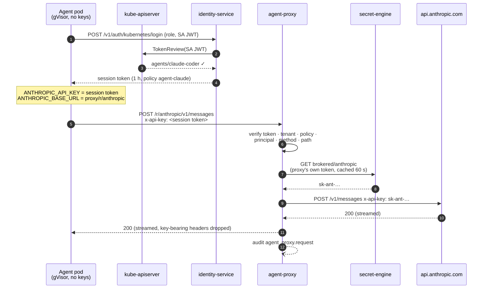

# agent-proxy: credential brokering for AI agents

An agent running in a sandbox should be able to call Anthropic, GitHub or an
MCP server **without ever holding the key**. `agent-proxy` makes that work:
the agent holds a one-hour wslvault *session token*. The real credential is
attached in flight by the proxy, which reads it from the vault with its own
identity.

The agent's credential lets it **be brokered**, not **fetch secrets**. A
leaked transcript, a prompt-injected `env | curl`, or a compromised container
exposes only a session token. That token:

- expires within the hour,
- works only through this proxy,
- works only for the routes its policy binds,
- cannot read the brokered secret from the vault (explicit `deny`),
- is audited on every use.

Companion to [`agentic-secret-management.md`](agentic-secret-management.md),
which covers the MCP read/write surface.

---

## 1. Flow



Kubernetes auth gives **mutual verification**. The cluster vouches for the
pod's ServiceAccount (TokenReview), and the agent only accepts a session token
from the vault endpoint it was configured with. The proxy authenticates the
same way under its own ServiceAccount and role.

## 2. What the proxy enforces

| Check | Failure |
|---|---|
| Session token present (Proxy-Authorization, X-Vault-Token, `Authorization: Bearer`, or the route's API-key header) | 401 / 407 |
| Token verifies (HS256 or EdDSA via JWKS, not expired) | 401 / 407 |
| Token tenant = the broker's tenant | 403 `tenant_mismatch` |
| Token holds one of the route's `allowed_policies` | 403 `policy_denied` |
| Principal (`namespace:serviceaccount`) matches `allowed_principals` | 403 `principal_denied` |
| Method in `allowed_methods`, path under `allowed_path_prefixes`, no dot-segments | 403 / 400 |
| Destination host is a configured route | 403 `egress_denied` |
| `CONNECT` tunnels | 403 `tunnel_refused` |

Every response carries `x-wslvault-proxy-error: <code>` on failure, so an agent
(or its operator) can tell a broker denial from an upstream error.

On the way out the proxy removes:

- hop-by-hop headers,
- `Host`, `Cookie` and `Authorization`,
- every `X-Vault-*` and `X-Wslvault-*` header,
- wslvault identity headers (`X-Tenant-Id`, …),
- the route's credential header and any `strip_headers`.

It then injects the brokered credential, marked sensitive so it is never
logged.

On the way back it drops hop-by-hop headers, and any header whose value
contains the secret.

Redirects are **not followed**: a 3xx goes back to the agent. If the proxy
followed it, a redirect to another host would receive the key.

Upstreams must be `https://`. Helm excludes private CIDRs from the proxy's
egress, so a route can't point a credential at an in-cluster service.

## 3. Two ways to send traffic

**Route mode (preferred).** Point the SDK's base URL at the route and put the
session token where the API key would go:

```bash
export ANTHROPIC_BASE_URL=http://wslvault-agent-proxy.wslvault.svc:8094/r/anthropic
export ANTHROPIC_API_KEY="$(cat /session/token)"   # a session token, not a key
claude -p "fix the flaky test"
```

The proxy recognises a JWT in the API-key slot and replaces it with the real
key. A non-JWT placeholder is rejected.

**Forward-proxy mode.** This is for tools that cannot change a base URL. Send
a plain `http://` request through `HTTP_PROXY` with `Proxy-Authorization:
Bearer <session token>`. The proxy matches the host against a route's `hosts`
and upgrades the connection to `https` towards the upstream.
`HTTPS_PROXY`/`CONNECT` is refused, because a TLS tunnel can be neither
brokered nor constrained.

**MCP servers** that speak streamable HTTP are just routes. See `github-mcp` in
[`examples/agent-proxy/routes.json`](../examples/agent-proxy/routes.json).
Request and response bodies are streamed, so SSE works.

## 4. Setting it up

The files in [`examples/agent-proxy/`](../examples/agent-proxy/) are a working
homelab layout:

| File | What |
|---|---|
| `identity-roles.json` | `VAULT_K8S_ROLES` for identity-service: one role for the proxy's SA, one per agent SA |
| `policies.json` | `agent-broker` reads `brokered/**`; `agent-claude` is explicitly **denied** it |
| `routes.json` | route table (Helm: `agentProxy.routes`) |
| `sandbox.yaml` | agent namespace, egress-only-via-broker NetworkPolicy, login init-container, agent pod |

```bash
# 1. Store the real credentials under brokered/ — readable by the broker only.
wslvault secret put brokered/anthropic api_key=sk-ant-…
wslvault secret put brokered/github    token=ghp_…

# 2. Create the two policies (tenant-scoped).
jq -c '.[]' examples/agent-proxy/policies.json | while read -r p; do
  curl -sX PUT "$VAULT/v1/policies/$(jq -r .name <<<"$p")" \
    -H "Authorization: Bearer $ADMIN" -H 'Content-Type: application/json' -d "$p"
done

# 3. Give identity-service the Kubernetes roles.
#    identityService.extraEnv: [{name: VAULT_K8S_ROLES, value: '<identity-roles.json>'}]

# 4. Enable the proxy.
helm upgrade wslvault deploy/helm/wslvault --reuse-values \
  --set agentProxy.enabled=true \
  --set-json "agentProxy.routes=$(cat examples/agent-proxy/routes.json)" \
  --set-json 'agentProxy.agentNamespaceSelector={"matchLabels":{"wslvault.io/agent-sandbox":"true"}}'

# 5. Launch an agent.
kubectl apply -f examples/agent-proxy/sandbox.yaml
```

**The one rule that makes this secure:** the agent's policy must not grant
read on the brokered paths. The example policy uses an explicit `deny`
(deny wins in policy-engine). That way a later broad grant such as
`secret/**` can't quietly undo it.

## 5. Configuration

| Variable | Default | Purpose |
|---|---|---|
| `VAULT_LISTEN_ADDR` | `0.0.0.0:8094` | |
| `VAULT_AGENT_PROXY_ROUTES_FILE` / `VAULT_AGENT_PROXY_ROUTES` | — | route table (file wins) |
| `VAULT_AGENT_PROXY_K8S_ROLE` | — | proxy's own Kubernetes-auth role (production) |
| `VAULT_AGENT_PROXY_SA_TOKEN_PATH` | SA default path | projected token, re-read at every login |
| `VAULT_AGENT_PROXY_TOKEN` | — | static broker token (development) |
| `VAULT_AGENT_PROXY_SECRET_TTL_SECS` | `60` | credential cache; also invalidated on an upstream 401 |
| `VAULT_AGENT_PROXY_ALLOW_HTTP_UPSTREAMS` | `false` | development only |
| `VAULT_JWT_SECRET`, `VAULT_JWKS_URL` | — | session-token verification |
| `VAULT_SECRET_ENGINE_ADDR`, `VAULT_IDENTITY_SERVICE_ADDR`, `VAULT_AUDIT_SERVICE_ADDR` | in-cluster names | backends |

Route fields:

- **Required:** `upstream`, `allowed_policies`, `secret_path` and
  `inject_header`.
- **Optional:** `hosts`, `allowed_principals` (a trailing `*` is a prefix
  match), `secret_key`, `inject_format` (default `{secret}`, e.g.
  `Bearer {secret}`), `allowed_methods`, `allowed_path_prefixes` and
  `strip_headers`.
- **Validation:** unknown fields, an empty `allowed_policies` and a non-https
  upstream all fail startup.

## 6. Known limits

- **No TLS interception.** `CONNECT` is refused rather than MITM'd. Tools must
  use a base URL or plain-http forward proxying. This is a deliberate trade:
  no CA has to be trusted inside the sandbox, at the cost of needing
  base-URL support.
- **The agent → proxy hop is cluster-internal HTTP.** It carries the session
  token, never the upstream key. Use a mesh or mTLS if your threat model
  includes on-node sniffing.
- **A stolen session token works through the proxy until it expires.** The
  proxy does not yet consult the durable revocation list (no
  `TokenRevocation` checker is installed, which needs database access), so
  revoking a session token does not cut it off early. Exposure is bounded by
  the token TTL (1 h, so prefer shorter agent roles) and the route bindings.
  It never yields the key itself.
- **Response bodies are not scanned.** An upstream that echoes the
  credential in a body would leak it. Header echoes are dropped.
- **One tenant per proxy deployment.** The broker's identity defines the
  tenant, and agents from other tenants are refused. Run one release per
  tenant.
