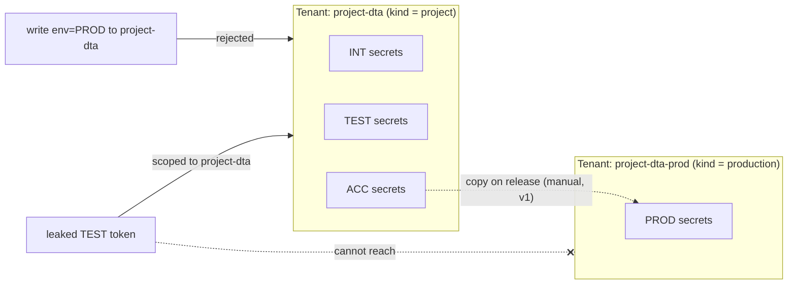
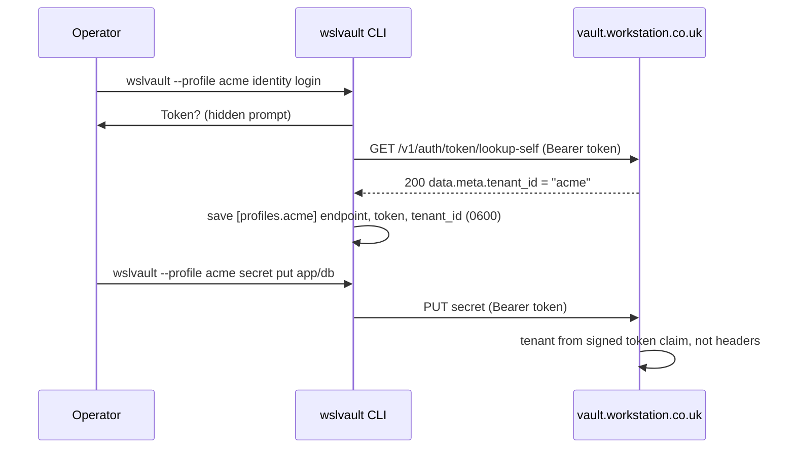
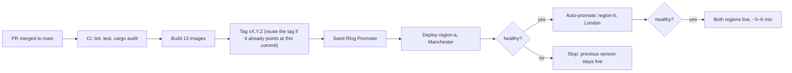

# Prompt: WSLVault autumn 2026 feature launch: blog, technical article, wslvault.org posts

Give this prompt to a writing and content agent that has access to this repo. It
is the brief for three pieces of launch content, plus the diagrams and
illustrations that go with them, covering what WSLVault shipped between v1.0.14
and v1.0.29 (September to October 2026).

---

## 1. Deliverables

| # | Piece | Audience | Length | Where it is published |
|---|-------|----------|--------|-----------------------|
| A | **Blog post** (less technical) | Founders, engineering managers, ops leads, buyers | 900–1,200 words | workstation.co.uk group sites, plus **jobshout.com/insights** |
| B | **Long technical article** | Platform/DevOps/security engineers | 3,000–4,000 words | wslvault.org (canonical), then syndicated to workstation.co.uk engineering pages and jobshout.com/insights |
| C | **wslvault.org blog items** | WSLVault users and evaluators | 3–4 short posts, 400–700 words each | wslvault.org `/blog` |

Each piece also needs:

- **2–4 flow diagrams**, written as Mermaid source (rendered to SVG for sites without Mermaid support)
- **1 hero illustration plus 1–2 inline illustrations**, delivered as image-generation prompts plus alt text
- **SEO metadata:** title (≤ 60 characters), meta description (≤ 155 characters), slug, 5–8 keywords, and an Open Graph title and description
- **Social copy:** a LinkedIn post (≤ 1,300 characters) and an X/Bluesky post (≤ 280 characters)

Output files go in `docs/marketing/launch-autumn-2026/`:

```
blog-business.md            # A
article-technical.md        # B
wslvault-org/<slug>.md      # C, one file per post
diagrams/<name>.mmd         # Mermaid sources
illustrations.md            # image prompts + alt text, keyed by filename
distribution.md             # per-site variants, canonical URLs, social copy
```

Every markdown file starts with frontmatter:

```yaml
---
title: ""
slug: ""
description: ""
date: 2026-10-16
author: "WSLVault team"
tags: []
canonical: ""        # B and its syndicated copies → the wslvault.org URL
hero: ""             # illustration filename
---
```

---

## 2. What shipped (the facts, all verified in this repo)

Use only these facts. Do not invent customers, benchmarks, certifications or
percentages. When a sentence needs a number, take it from this list.

### 2.1 Secret tags and SDLC environments, with project and production tenancy
*(PR #77, `docs/operations/secret-tags-and-environments.md`)*

- Every KV secret now carries an **environment** (`INT`, `TEST`, `ACC` or `PROD`) and free-form **tags** such as `database`, `api-key` or `app:billing`.
- Tenants have a **kind**:
  - A **project** tenant (for example `project-dta`) holds INT, TEST and ACC.
  - A **production** tenant (for example `project-dta-prod`) holds PROD only.
- The API **rejects** `environment=PROD` in a project tenant with a clear error. Production lives in its own tenant, so a leaked lower-environment credential cannot reach it. This is the "blast radius" story.
- The console has environment and tag inputs when creating a secret, an environment filter, and a tenant-kind selector. The API supports filters such as `?environment=TEST&tag=database`.
- **Be honest about v1 limits:**
  - Policies are still path-based. Environment and tags are enforced on write against the tenant's allowed environments, but policy documents can't filter by them yet.
  - Moving a secret from ACC to PROD means copying it into the production tenant. There is no automatic promotion.
- Environment is **not** the same as region. The geo-regions (Manchester and London) are a separate feature.

### 2.2 The token decides the tenant (CLI `login` and `init`)
*(PR #80, `wslvault-cli/README.md`)*

- The server takes the tenant from the signed token's `tenant_id` claim, never from a request header. The header path is off unless `VAULT_TRUST_GATEWAY_HEADERS` is enabled.
- `wslvault identity login` checks the token with the server (`/v1/auth/token/lookup-self`), then saves the token, its endpoint and its tenant to `~/.wslvault/config.toml`. The file is owner-only (`0600`).
  - If the token is left off the command, the CLI prompts for it, so it stays out of shell history.
  - `--profile <name>` stores the token in a named profile. That gives one profile per tenant: `wslvault --profile acme secret put …`.
- `wslvault init` now asks for an optional token and checks it the same way.
- If you point the CLI at the web console instead of the API host, the error tells you so.

### 2.3 Merge-to-production in two regions, hands-off (Ring Promoter)
*(PR #79, `.github/workflows/ci.yml`, `deploy/ring-promoter/`)*

- When a pull request is merged to `main`, CI builds 13 service images, tags a release (`vX.Y.Z`) and **seeds Ring Promoter**. Ring Promoter deploys region-a (Manchester), checks it is healthy, then **auto-promotes** to region-b (London) and checks again.
- Observed on v1.0.27–v1.0.29: about **5–6 minutes** from seed to both regions healthy, with no manual step. All 13 deployments were ready in both regions.
- PR #79 fixed a race. Two workflows competed to create the release tag, and when the other one won, the deploy was skipped. CI now releases whichever version tag points at the merged commit.
- Rollback is simply the previous ring version. Ring Promoter records `previous_version`.

### 2.4 Security hygiene shipped alongside
- **Policy changes need an admin** (PR #74). A tenant's own token can no longer rewrite its own policies.
- **Dependency audit gate:** `cargo audit` runs on every push. This cycle patched `rustls` 0.23.46 and `quinn-proto` 0.11.19 (RUSTSEC-2026-0338/0340/0343/0346–0349) the day the advisories landed.
- Invitation emails work again (identity-service can now reach the SMTP relay, PR #75).

### 2.5 Polish
- The console and wslvault.org now use the workstation.co.uk type system: **Unbounded** for display, **Poppins** for body text, **JetBrains Mono** for code (PR #78).

### 2.6 Context already live (mention, don't headline)
Self-service TOTP two-factor authentication with recovery codes, a web console,
envelope encryption (AES-256-GCM with a per-tenant key hierarchy), a signed
hash-chain audit log, Shamir-split root key, transit, PKI, leases, active/active
replication across two regions, an MCP server, and four SDKs. Open source:
https://github.com/bwalia/wslvault

---

## 3. Angles and tone per piece

### A. Blog post (business, less technical)
- **Headline direction:** "Keep production secrets out of reach — even from your own test environments", or "Shipping to two regions in five minutes, without anyone pressing deploy".
- **Structure:**
  1. A relatable problem: a staging password leaks, and suddenly someone is asking whether it can reach production.
  2. What WSLVault now does, covering features 2.1–2.3 in plain words.
  3. Why it matters: smaller blast radius, fewer human release steps, clear ownership per tenant.
  4. A "what this looks like day to day" walkthrough.
  5. A call to action.
- **Tone:** confident, warm and concrete. Explain any jargon the first time it appears ("a tenant is a walled-off space for one team or project"), and use no jargon at all in headings. British English.
- **Per-site variants** (in `distribution.md`):
  - **jobshout.com/insights:** frame it as engineering-culture and team-productivity content, e.g. "what good release hygiene says about a team".
  - **workstation.co.uk sites:** frame it as a capability of the workstation.co.uk platform group.
  - Keep around 80% of the body shared and rewrite the intro, conclusion and call to action for each site.

### B. Long technical article
- **Headline direction:** "Environment-aware secrets, token-derived tenancy, and hands-off multi-region rollout in WSLVault".
- **Sections:**
  1. Threat model: why lower-environment and production secrets must not share a trust boundary.
  2. Data model: `environment` and `tags` columns, tenant `kind` and `allowed_environments`, migration 035, and where enforcement happens. Include an API example with `curl` and a JSON response.
  3. Identity: precedence in `crates/wslvault-core/src/auth.rs`. Show the token claims, why header trust is off by default, and how `lookup-self` works.
  4. CLI walkthrough: `init`, `identity login`, profiles per tenant, the `0600` config. Show a short terminal session as a code block.
  5. The release pipeline: CI jobs, the tag-race bug, and its fix. Show a before/after excerpt of the `ci.yml` logic. Then Ring Promoter rings, health gates and auto-promote.
  6. Supply chain: the audit gate, and patching advisories the same day.
  7. Limitations and roadmap: path-based policies (environment-aware policies come next), copy-based ACC→PROD promotion, and the E2E suite being repaired.
  8. Try it: links to the repo, docs and GETTING-STARTED.md.
- **Tone:** precise and candid. Show real snippets from the repo, and present trade-offs honestly. No marketing superlatives.

### C. wslvault.org blog items (similar impact, product-voice)
Write one focused post per feature, each with one diagram and a "try it in 60 seconds" block:
1. "Tags and environments: find any secret, keep PROD separate"
2. "`wslvault identity login`: one profile per tenant"
3. "From merge to two regions in about five minutes"
4. *(optional)* "October security roundup: admin-only policy changes and same-day patches"

Each post ends with a link to the long article (B) for depth.

**wslvault.org has no blog route yet.** The site is a Next.js static export in `www/`. Add:
- `www/content/blog/*.md`, with the frontmatter above
- `www/src/app/blog/page.tsx`, an index newest-first
- `www/src/app/blog/[slug]/page.tsx`, built with `generateStaticParams`
- Blog URLs in `www/src/app/sitemap.ts`, and a "Blog" link in the site nav

Match the existing steel/brass styles in `www/src/app/globals.css`. Don't add a CMS. Keep it static so Pages deploys keep working.

---

## 4. Diagrams (Mermaid; refine but keep the facts)

**D1 — Project vs production tenancy (used in A, B, C1)**


**D2 — Token decides the tenant (used in B, C2)**


**D3 — Merge to two regions (used in A, B, C3)**


**D4 — Tag race, before and after (B only)**: a two-lane sequence diagram. Auto Tag creates `vX.Y.Z` while CI is building.
- **Before:** CI sees the tag exists, sets `tag_created=false`, and skips the seed, so nothing is deployed.
- **After:** CI sees the tag points at this commit, sets `tag_ready=true`, and seeds Ring Promoter.

Render every diagram in **both light and dark** variants, using the brand colours below.

---

## 5. Illustrations

**Brand system:**
- Steel `#11161d` / `#1a212b`, brass accent `#c9a227`, navy `#27507a`, light canvas `#f6f7f9`
- Fonts: Unbounded (display), Poppins (body)
- **Visual metaphor:** a precision-engineered vault and instrument panel. Brushed steel, brass fittings, calm and confident.
- **Avoid:** hooded hackers, padlocks-on-circuit-boards, glowing binary rain and similar clichés.

For each illustration, write in `illustrations.md`:
- the filename
- the placement (which piece, which section)
- a 60–100 word image-generation prompt
- a negative prompt
- the aspect ratio: hero 16:9 at 1600×900, inline 4:3, social 1200×630
- alt text of 125 characters or fewer

**Required set:**
1. **Hero (A, B):** two brass-trimmed steel vault doors side by side, labelled softly "project" and "production". A gentle glow sits between them, and they are clearly separate.
2. **Release rings (A, B, C3):** concentric brass rings on a steel instrument panel, with two indicator lamps (Manchester, London) lighting in sequence.
3. **Profiles (C2):** a terminal window on brushed steel showing `[profiles.acme]`, with a brass key tag hanging from it.
4. **Tags (C1):** filing-drawer labels in brass, marked INT, TEST and ACC, with a separate locked drawer marked PROD.
5. **Social card template:** a steel background, a brass rule, and room for the title in Unbounded.

No text inside generated images except short labels, which may be added afterwards in design tooling.

---

## 6. Distribution and SEO rules

- The canonical URL for B is on wslvault.org. Every syndicated copy sets `rel=canonical` to it, and A's variants link to B.
- Don't publish the same text on two sites without a canonical. Rewrite the A variants as described in section 3.
- **Internal links:** wslvault.org ↔ GitHub repo ↔ the relevant docs (`docs/tenancy.md`, `docs/security-model.md`, `docs/ha-two-region.md`).
- **Keywords to consider:** multi-tenant secrets management, self-hosted vault, Vault alternative, environment-separated secrets, SDLC environments, multi-region Kubernetes deployment, progressive delivery, secrets CLI.
- **Accessibility:** alt text on every image, diagrams described in a sentence in the body text, no information conveyed by colour alone.

---

## 7. Quality bar (check before handing back)

- [ ] Every product claim traces to section 2. No invented numbers, customers or compliance badges.
- [ ] The v1 limits (path-based policies, copy-based promotion) appear in B and at least briefly in C1.
- [ ] A has no unexplained jargon, and a non-engineer could repeat its main point.
- [ ] B's code and config snippets match the repo (check `ci.yml`, `auth.rs` and the CLI README).
- [ ] Hostnames: use only `vault.workstation.co.uk` (API) and `vault-ui.workstation.co.uk` (console) as examples. No internal tokens, IPs, node names or kubeconfig paths.
- [ ] Mermaid renders (check with `npx @mermaid-js/mermaid-cli`), with light and dark SVGs exported.
- [ ] The wslvault.org blog builds: `cd www && npm run build` succeeds, and `/blog` plus each post appear in the static export and the sitemap.
- [ ] British English, sentence-case headings, no em-dash overuse.
